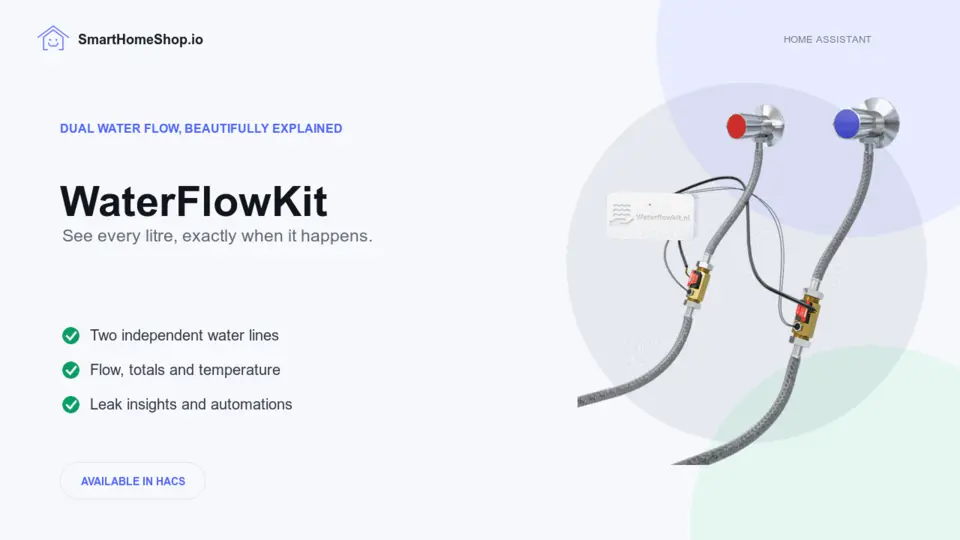

# SmartHomeShop.io for Home Assistant

[](https://my.home-assistant.io/redirect/hacs_repository/?owner=smarthomeshop&repository=home-assistant-integration&category=integration)
[](https://github.com/smarthomeshop/home-assistant-integration/releases/latest)

The official Home Assistant integration for SmartHomeShop.io devices. It turns
your water, energy and presence sensors into ready-to-use dashboards, a 2D/3D
floor plan with live presence, and Smart Energy that plans your battery, car
and appliances around energy prices and solar.

- **Device pages and Lovelace cards** for every SmartHomeShop.io product.
- **Floorplan Designer**: draw your home in 2D/3D, place your sensors and see
  where people are, live.
- **Room presence** from one or more radars per room, with room occupancy,
  temperature, humidity and CO2 entities.
- **Smart Energy**: dynamic prices, Home Assistant Energy sync, home battery
  planning, Smart EV charging and Smart Loads.
- **Leak detection** for the water kits.
- Available in English, Dutch, German, French and Spanish.

https://github.com/user-attachments/assets/4ae4f82c-ce34-4ee5-94c5-f45d7761d2e5

## Contents

- [Supported devices](#supported-devices)
- [Installation](#installation)
- [Adding your devices](#adding-your-devices)
- [The SmartHomeShop.io panel](#the-smarthomeshopio-panel)
- [Floorplan Designer and presence](#floorplan-designer-and-presence)
- [Smart Energy](#smart-energy)
- [Lovelace cards](#lovelace-cards)
- [Updating](#updating)
- [Support](#support)
- [License](#license)

## Supported devices

| Device | What you get |
| --- | --- |
| **WaterP1MeterKit** | Electricity and gas from your P1 smart meter, plus water usage and leak detection |
| **P1MeterKit** | Electricity and gas readings from your P1 smart meter |
| **WaterMeterKit** | Water usage tracking and leak detection |
| **WaterFlowKit** | Flow monitoring for up to four water lines, with leak detection |
| **UltimateSensor** and **UltimateSensor Mini** | Room comfort (temperature, humidity, CO2, air quality) and radar presence |
| **CeilSense** | Ceiling-mounted presence and room sensing |
| **WallSense** | Wall-mounted presence and room sensing |

All devices run ESPHome and work fully local. A SmartHomeShop.io account is
only needed for Smart Energy prices and the solar forecast.

## Installation

### Marketplace (Home Assistant 2026.11 and newer)

SmartHomeShop.io is part of the default catalog of the Home Assistant
Marketplace.

1. Go to **Settings > Marketplace**.
2. Search for **SmartHomeShop.io** and open it.
3. Select **Install** and confirm the version.

Or open it directly in your Home Assistant:

[](https://my.home-assistant.io/redirect/hacs_repository/?owner=smarthomeshop&repository=home-assistant-integration&category=integration)

Already installed it with HACS? Home Assistant 2026.11 moves it into the
Marketplace for you. Nothing changes: you keep your devices, settings and
updates.

### HACS (Home Assistant 2026.10 and older)

1. Open **HACS** and search for **SmartHomeShop.io**.
2. Select **Download**.
3. Restart Home Assistant.

### Manual

1. Download the latest [release](https://github.com/smarthomeshop/home-assistant-integration/releases/latest).
2. Copy `custom_components/smarthomeshop` into the `custom_components` folder
   of your Home Assistant configuration.
3. Restart Home Assistant.

## Adding your devices

Your device must already be online in Home Assistant through the **ESPHome**
integration.

1. Go to **Settings > Devices & services > Add integration** and search for
   **SmartHomeShop.io**.
2. Pick your product and the ESPHome device that belongs to it.
3. Check the summary and finish.

Repeat this for every device. The entities this integration adds end in
**(CC)**, so you can tell them apart from the ESPHome entities.

## The SmartHomeShop.io panel

After setup, **SmartHomeShop.io** appears in the sidebar. It has three parts:

- **Dashboard**: all your devices with live values. Open a device for its
  overview, settings, automations and, for radars, a live 2D/3D view of the
  detected people.
- **Floorplan Designer**: your home in 2D and 3D, with live presence.
- **Energy**: live energy flow, prices and all Smart Energy settings.

## Floorplan Designer and presence

Draw your rooms or import them (including Apple RoomPlan scans), place them on
floors and add doors, windows, mirrors and furniture. Then place your
UltimateSensor, UltimateSensor Mini, CeilSense and WallSense radars where they
hang in real life. Administrators edit the plan; other users see the live view.

- **Live positions** for LD2450, LD2460 and LD6002B radars. Presence-only
  radars such as LD2412 show presence for the whole room instead of a made-up
  position.
- **Several radars in one room.** A room is occupied as soon as one selected
  radar sees someone, and only clear when every selected radar reports clear
  for the clear delay. Missing or stale data gives unknown, never a false
  clear.
- **Room entities** for occupancy, temperature, humidity and CO2, ready for
  your automations. Climate can use the average, one primary sensor or stay
  separate per sensor.
- **Zones** for detection, exclusion and entry lines, sent straight to the
  radar. Mirrors can get reflection protection against ghost targets.
- **Radar settings** for a selected sensor: hardware settings, coverage
  calibration, sensor fusion and height mapping.

Cross-radar fusion is experimental and off by default. A built-in walk test
checks the overlap between radars before it can be turned on.

The radar firmware contract lives in the
[radar-mounting repository](https://github.com/smarthomeshop/radar-mounting).

## Smart Energy

Connect your SmartHomeShop.io account under **Energy > Settings** to get
dynamic prices and the solar forecast, and pick the P1 meter Smart Energy
should use. From there you can:

- **Sync Home Assistant Energy** with your meters, so the Energy dashboard is
  set up for you.
- **Plan your home battery** around prices, solar and your normal house load.
- **Charge your car with Smart EV**: up to eight vehicles, ready by a time you
  set or the next calendar event, using cheap hours and solar.
- **Run appliances with Smart Loads**: up to sixteen washing machines,
  dishwashers, boilers, heat pumps or switches, planned before a ready-by time.
  It learns how long each one runs.
- **Use ready-made automations** and price-based schedules for any device.

### Built to be safe

- Everything starts in **Advice only** and never touches your hardware. Try
  **Shadow mode** next to see what would happen, and only then switch to
  **Automatic**.
- The live P1 and main fuse guard is always on. Every command is checked
  against a fresh grid reading right before it is sent. Missing or stale data
  stops a command instead of guessing.
- The battery, Smart EV and Smart Loads share one control lock and one power
  budget, so they never fight over a device or promise the same headroom
  twice.
- Smart EV and Smart Loads only stop what they started themselves. A charger
  or appliance you start by hand is never taken over.
- A decision journal explains every advice, limit and command. All learning
  data stays in Home Assistant.

Set the right number of phases for your main connection and your car before
using automatic mode: a wrong phase count makes the fuse calculation unsafe.

The current battery advice can also be applied from an automation:

```yaml
action: smarthomeshop.apply_battery_recommendation
data: {}
```

## Lovelace cards

The cards are added automatically. Find them in the card picker by searching
for **SmartHomeShop**.

| Card | For |
| --- | --- |
| Water, WaterP1 and WaterFlowKit cards | Water usage, flow, leaks and meter readings |
| P1MeterKit card | Live grid power, tariffs and phases |
| UltimateSensor and CeilSense cards | Presence, zones and room climate |
| Live Home card | Live 2D/3D presence for the whole home, one floor or one room |
| Energy cards | Live flow, price outlook, power trend, costs, savings and Smart Energy automations |

Example of the Live Home card in YAML:

```yaml
type: custom:smarthomeshop-home-presence-card
title: Live Home
floor: all        # or a floor number, for example 0
view: 3d          # or 2d
height: 430
```

Use `room_id` instead of `floor` to show a single room.

### See it in action

[](https://github.com/smarthomeshop/home-assistant-integration/blob/main/docs/media/smarthomeshop-utility-cards-demo.mp4)

| WaterFlowKit | CeilSense | UltimateSensor |
| --- | --- | --- |
| [](https://github.com/smarthomeshop/home-assistant-integration/blob/main/docs/media/smarthomeshop-waterflowkit-demo.mp4) | [](https://github.com/smarthomeshop/home-assistant-integration/blob/main/docs/media/smarthomeshop-ceilsense-demo.mp4) | [](https://github.com/smarthomeshop/home-assistant-integration/blob/main/docs/media/smarthomeshop-ultimatesensor-demo.mp4) |

## Updating

Update from the Marketplace (or HACS) and restart Home Assistant. Your rooms,
device links, energy settings and statistics are kept. Release notes are on the
[releases page](https://github.com/smarthomeshop/home-assistant-integration/releases).

### Notes for 1.17

- The first start upgrades the room storage. A copy of the old data is kept in
  `.storage/smarthomeshop.rooms.backup_1_1`, and 1.16 can still read the new
  file if you need to go back.
- Room Designer and Live Home are now one page: the **Floorplan Designer**.
- A room with one damaged setting is repaired instead of hidden. **Settings >
  Repairs** lists it until you confirm.
- Earlier versions allowed one radar in two rooms. Those rooms now show
  presence as unknown and Repairs tells you which radar it is. Unlink it from
  all but one room in the Floorplan Designer.

### Water and gas

- The Energy sync uses **Water Total Consumption** as the water source. It
  starts at 0 again after a restart of the kit, which Home Assistant handles as
  a new meter cycle. The old `sensor.<device>_water_meter_total_cost` entity is
  left behind as unavailable and can be deleted under **Settings > Devices &
  services > Entities**.
- The **Usage today/this week/this month/this year (CC)** sensors use the water
  device class, so you can pick the unit in their entity settings.
- Without a gas meter, no gas helpers are created. Old **Gas Daily, Weekly,
  Monthly and Yearly (CC)** helpers can be deleted under **Settings > Devices &
  services > Helpers**.

## Support

- [Documentation](https://docs.smarthomeshop.io)
- [Report an issue](https://github.com/smarthomeshop/home-assistant-integration/issues)

## License

Copyright (c) 2025-2026 SmartHomeShop.io.

The integration source code is licensed under the
[GNU Affero General Public License v3.0](https://github.com/smarthomeshop/home-assistant-integration/blob/main/LICENSE). Modified versions and
network-accessible derivatives must remain available under the AGPL.

The SmartHomeShop.io name, logos, product names and brand assets are not
licensed under the AGPL. See [TRADEMARKS.md](https://github.com/smarthomeshop/home-assistant-integration/blob/main/TRADEMARKS.md). A separate
commercial license is available for organizations that want to incorporate
this software without the AGPL obligations; contact info@smarthomeshop.io.
